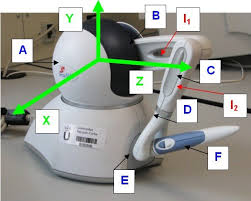

# Phantom Omni

**Python library and setup guide for the 3D Systems Phantom Omni haptic device on Windows.** It reads the stylus
position, velocity, joint and gimbal angles and buttons, and sends forces, over FireWire with the OpenHaptics HDAPI
via `ctypes`; no ROS required.

[Setup](#setup--installation) · [Drivers and SDK download](../../releases) · [Commands](commands.md) ·
[Discord](https://discord.com/invite/prjUvjmGpZ)

[](LICENSE)
[](#requirements)
[](https://discord.com/invite/prjUvjmGpZ)


## Requirements

| Requirement | Details |
|---|---|
| OS | Windows 10 (x64) |
| Hardware | PCIe FireWire card (tested with Digitus DS-30201-5 3+1) |
| Device drivers | Phantom Device Driver v5.1.7 (FireWire/Parallel) |
| SDK | OpenHaptics Developer Edition v3.4.0 |
| Python | 3.x |

> **Note:** The Phantom Omni is a 20+ year old device. Setting it up requires legacy FireWire drivers and the OpenHaptics SDK.

> **Download:** All required drivers (FireWire legacy driver, Phantom Device Driver) and the OpenHaptics SDK are bundled together in the [GitHub Releases](../../releases) of this repository for convenience.


## Setup & Installation

### 1. FireWire Driver

Windows 8 and later ship without the legacy 1394 OHCI driver that the Phantom Omni requires.

1. Download the legacy driver from [Microsoft Support](https://support.microsoft.com/en-us/topic/firewire-port-based-device-does-not-work-correctly-in-windows-8-1-or-windows-8-2242eed9-e8e2-00eb-c854-9335ea06c5fe) for your architecture (x64 or x86).
2. Install `Legacy1394.inf`. The driver files are typically located at:  
   `C:\Program Files (x86)\1394 OHCI Compliant Host Controller (Legacy)\x64_driver`
3. A community guide for Windows 8/10 is available [here](https://kyle.machul.is/2016/10/03/using-a-firewire-phantom-omni-on-windows-8-10/).

### 2. Phantom Device Driver

Download and install **Phantom Device Driver v5.1.7** for FireWire/Parallel devices from [3D Systems Support](https://support.3dsystems.com/s/article/Haptic-Device-Drivers?language=en_US).  
The full installation guide (PDF) is available [here](https://s3.amazonaws.com/dl.3dsystems.com/binaries/support/downloads/Sensable/3DS/PDD_InstallGuide.pdf).

### 3. OpenHaptics SDK

Download `OpenHaptics_Developer_Edition_v3.4.0.zip` from:
- [Oqton Software Support](https://softwaresupport.oqton.com/s/article/OpenHaptics-for-Windows-Developer-Edition-v34?language=en_US) or
- [3D Systems Support](https://support.3dsystems.com/s/article/OpenHaptics-for-Windows-Developer-Edition-v34?language=en_US)

After installation, make sure the OpenHaptics `bin` directory (containing `HD.dll`) is on your system `PATH`, or copy `HD.dll` to `C:\Windows\System32`.

### 4. Python Dependencies

This library uses only the Python standard library (`ctypes`, `os`, `sys`, `time`). No additional packages are required.


## Testing the Device

Before running any Python code, you can verify the device is working correctly using the **Phantom Test** and **Phantom Configuration** GUI tools that are installed alongside the Phantom Device Driver. These allow you to test connectivity, calibration, and force feedback without writing any code.


## Running the Code

Clone or download this repository, then run the included test script:

```bash
python test.py
```

This initialises the device and continuously prints the end-effector position and velocity to the console. Press **Ctrl+C** to stop.

For a minimal custom script:

```python
import time
from phantom import PhantomOmni

omni = PhantomOmni()

try:
    for _ in range(100):
        state = omni.get_state()
        print("Position:", state["position"])
        time.sleep(0.1)
finally:
    omni.close()
```


## Phantom Omni Axes

The diagram below shows the coordinate system and joint axes used by the Phantom Omni. The origin is at the base of the device.



| Axis | Description |
|---|---|
| X | Points to the right (from the device's perspective) |
| Y | Points upward |
| Z | Points toward the user |

Joint angles are reported as `[waist, shoulder, elbow]` in radians. Gimbal angles are reported as `[yaw, pitch, roll]` in radians.


## API reference

<details>
<summary>The <code>PhantomOmni</code> class: every call, its arguments and what it returns</summary>

> **Note:** Only `get_position()` and `get_velocity()` (via `get_state()`) have been fully tested and confirmed working on hardware. Other API calls — including gimbal angles, joint torques, and force output — are implemented based on the OpenHaptics HDAPI specification but **have not been fully verified** on this specific device setup. Use them with caution.

### `PhantomOmni(device_name=None)`
Initialises the device. Pass `None` to connect to the default device.

### `get_state()` → `dict`
Returns a dictionary with the full device state:
- `position` — Cartesian position `[x, y, z]` in mm
- `velocity` — Cartesian velocity `[x, y, z]` in mm/s
- `joint_angles` — Waist, shoulder, elbow angles in radians
- `gimbal_angles` — Yaw, pitch, roll angles in radians
- `buttons` — Button bitmask (integer)

### `get_position()` → `list[float]`
Returns `[x, y, z]` position in mm.

### `get_velocity()` → `list[float]`
Returns `[x, y, z]` velocity in mm/s.

### `get_gimbal_angles()` → `list[float]`
Returns `[yaw, pitch, roll]` in radians.

### `get_buttons()` → `dict`
Returns `{"button1": bool, "button2": bool}` for the stylus buttons.

### `set_force(fx, fy, fz)`
Sends a force command to the device in Newtons.

### `close()`
Stops the scheduler and releases the device. Always call this (or use `try/finally`) when finished.

</details>

## Additional Resources

- [URDF files for Phantom Omni](https://github.com/gripsCAR/phantom_omni)
- [OpenHaptics Documentation](https://s3.amazonaws.com/dl.3dsystems.com/binaries/support/downloads/Sensable/3DS/PDD_InstallGuide.pdf)


## Community

Ask in [Discussions](https://github.com/orgs/Source-Robotics/discussions), chat on
[Discord](https://discord.com/invite/prjUvjmGpZ), report a bug in
[Issues](https://github.com/Source-Robotics/Source-Robotics-Phantom-Omni/issues). Follow Source Robotics:

[](https://discord.com/invite/prjUvjmGpZ)
[](https://github.com/orgs/Source-Robotics/discussions)
[](https://www.youtube.com/@source-robotics)
[](https://www.instagram.com/source_robotics/)
[](https://x.com/SourceRobotics)
[](https://www.linkedin.com/company/source-robotics/)
[](https://source-robotics.com/blogs/blog)

## Licensing

The library is under the [MIT License](LICENSE).
